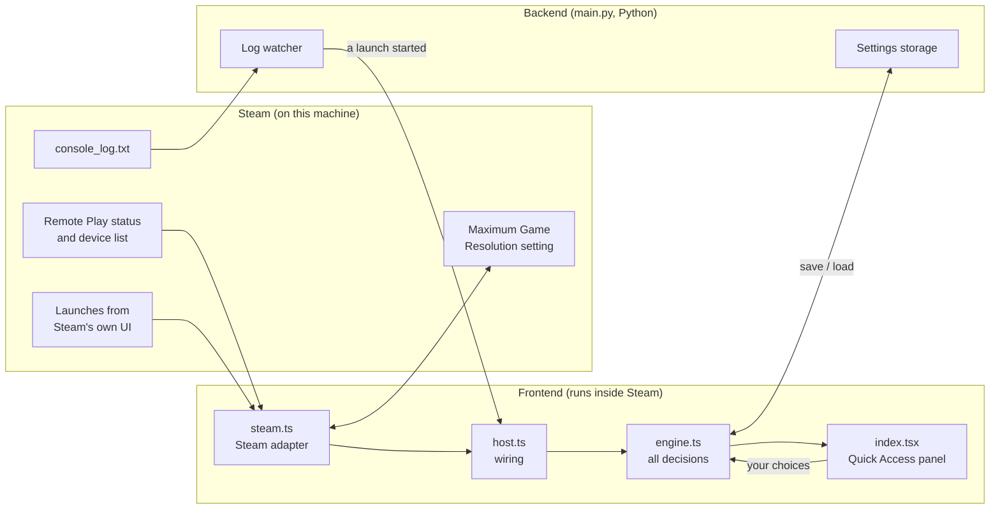

# How Gaugeshift works

This is a guide to the code: what each part does, how they fit together, and why it's built this way. It's written to be read top to bottom, by someone who has never seen the code.

## The idea in one paragraph

Steam has a setting called **Maximum Game Resolution**: games launched while it's set won't run above that resolution. Gaugeshift watches for devices that start streaming from this machine. When one does, it changes that setting to the resolution you picked for that device, after first saving the current value. When the stream ends, it puts the saved value back. Everything else in the code exists to make those two steps reliable.

## The parts

| File                      | What it does                                                                                                                                                                                                                                                                                                                                                                               |
| ------------------------- | ------------------------------------------------------------------------------------------------------------------------------------------------------------------------------------------------------------------------------------------------------------------------------------------------------------------------------------------------------------------------------------------ |
| `src/engine.ts`           | **Makes every decision.** It receives events ("iPhone connected", "a launch started", "the user picked 1920x1200") and decides what to do. It never talks to Steam directly. Everything it needs, like reading the setting, changing it, saving or setting a timer, it asks for through a small interface called `Host`. That's what makes it testable: the tests give it a pretend Steam. |
| `src/steam.ts`            | **Talks to Steam.** It contains small wrappers around the Steam functions Gaugeshift uses, and the code that encodes a setting change the way Steam expects.                                                                                                                                                                                                                               |
| `src/host.ts`             | **Connects things.** It gives the engine the real Steam (through `steam.ts`) and the real backend, and passes Steam's events to it.                                                                                                                                                                                                                                                        |
| `src/index.tsx`           | **The panel** in the Quick Access Menu: the on/off switch, the status, warnings, and a resolution menu for each device.                                                                                                                                                                                                                                                                    |
| `main.py`                 | **The backend**, which runs as a separate Python process:  • **Settings storage:** it saves your rules and the "what to restore" record to a file. It checks everything it's given and writes the file in a way that can't leave it half-written.  • **Log watcher:** it reads Steam's console log and reports each game launch as it starts.                                        |
| `scripts/check_safety.py` | Fails the build if Gaugeshift ever gains abilities it shouldn't have, such as root, network access or running programs. See [SECURITY.md](SECURITY.md).                                                                                                                                                                                                                                    |

## What happens when…

### …a phone connects with Steam Link

1. Steam reports a stream to "iPhone". The engine records the device and looks up its rule, say 1920x1200.
2. It reads the current setting, say 1920x1080, and **saves a record**: "changed for iPhone; put back 1920x1080". This is saved _before_ anything changes, so a crash at any moment can't lose the original value.
3. It changes the setting, and waits until Steam reports the new value. If Steam doesn't, it tries again, up to three times.
4. A notification confirms the change.

When the phone disconnects, the engine checks the setting is still the value it set. If so, it puts back 1920x1080 and deletes the record. If you changed the setting yourself in the meantime, it leaves your value alone.

### …a Steam Deck launches a game with "Stream"

This case is harder. The Deck asks this machine to start the game, and Steam only reports the stream once the game is **already starting**, which is too late, because the game has already read the setting.

1. Steam writes a line to its console log the moment any launch begins, several seconds before the game starts. The backend's **log watcher** sees it and tells the engine.
2. Launches started on this machine's own screen, or over Steam Link, go through Steam's UI, which reports them separately. The engine waits a moment for that report. If it doesn't come, and nothing is streaming yet, the launch must have come from another device.
3. Steam doesn't say _which_ device asked. The engine picks the **online device with a rule** that streamed most recently, and applies its rule straight away.
4. When the stream connects a few seconds later, Steam names the device. If the guess was right, nothing changes. If it was wrong, the engine switches to the right device's rule. If no stream follows within a minute, it undoes the change.

### …Steam, Decky or the machine restarts mid-stream

When Gaugeshift starts, Steam immediately reports whether something is streaming:

- **Nothing is streaming, but a "put back" record exists:** the change was left behind, so the engine restores it.
- **A device is streaming:** the engine applies (or keeps) that device's rule.

When Gaugeshift is turned off, disabled, updated or uninstalled, it restores the setting before it unloads.

### …something goes wrong

| Problem                                                  | What the engine does                                                                               |
| -------------------------------------------------------- | -------------------------------------------------------------------------------------------------- |
| It can't read the current setting                        | Changes nothing, since it couldn't restore later, and shows a warning                              |
| Steam doesn't accept a change                            | Retries, then gives up cleanly and shows a warning                                                 |
| Steam doesn't accept a restore                           | Keeps the record and tries again on the next stream, the next start, or when you press **Restore** |
| The log watcher misses a launch that Steam's UI reported | Shows a warning that Deck-style launches can't be detected on this Steam version                   |
| Anything unexpected                                      | Logs it and carries on with the next event; one error can't stop it                                |

## Design decisions

- **One event at a time.** The engine handles events in a queue, strictly in order, so a quick connect, disconnect and reconnect can never interleave and leave the setting in a mixed state.
- **Save before change.** The "put back" record is always saved before the setting changes. Whatever happens next, the original value is on disk.
- **Do nothing when unsure.** Every uncertain situation (a value it can't read, a change it can't confirm) ends with the setting left alone and a visible warning, never with a guess.
- **Respect the user.** If the setting isn't the value Gaugeshift set, someone changed it on purpose, so Gaugeshift doesn't touch it.
- **All decisions in one place.** `engine.ts` contains every rule about _what_ should happen, and nothing about _how_ to talk to Steam. That separation is what allows about 90 tests, including randomized stress tests, to check the decisions without a Steam Machine.
- **A small, stable backend.** The backend only stores data and watches the log. Its method names (`get_config`, `save_config`, `log`) must stay the same across versions, because during an update the old frontend may still call the new backend.

## The parts of Steam Gaugeshift relies on

None of these are officially documented by Valve, so a Steam update could change them. Each is used in one place, so a fix would be small:

| What                                                                                | Where                            | If it changes…                                                    |
| ----------------------------------------------------------------------------------- | -------------------------------- | ----------------------------------------------------------------- |
| `settingsStore.m_ClientSettings.gamescope_game_resolution_global`                   | `steam.ts` (`getGameResolution`) | Gaugeshift can't read the setting: it warns and changes nothing   |
| `SteamClient.Settings.SetSetting` with field number 21012                           | `steam.ts` (`setGameResolution`) | Changes aren't confirmed: it warns                                |
| `SteamClient.RemotePlay.RegisterForSettingsChanges` (`strStreamingClientName`)      | `steam.ts`                       | Streams aren't detected                                           |
| `SteamClient.RemotePlay.RegisterForDevicesChanges`                                  | `steam.ts`                       | Deck-style launches can't pick a device                           |
| `SteamClient.Apps.RegisterForGameActionStart`                                       | `steam.ts`                       | Local launches may be mistaken for remote ones                    |
| The console-log line `GameAction [AppID …, ActionID …] : LaunchApp changed task to` | `main.py` (`LAUNCH_RE`)          | The health check warns that Deck-style launches can't be detected |

## Working on the code

See **Development** in the [README](README.md#development) for the commands. A good order to read the code:

1. Start with `src/engine.ts` from `handleStreamState` downwards: that's the heart of it.
2. Read `tests/frontend/engine.test.ts` next to it. Each test is a short story of one situation.
3. Then `main.py`, then `src/steam.ts`, `src/host.ts` and `src/index.tsx`.

When changing behavior, add or change a test in `tests/frontend/engine.test.ts` first, and run `pnpm check`. If the stress tests in `tests/frontend/stress.test.ts` fail, they print the shortest sequence of events that breaks one of Gaugeshift's promises. Replay it as a normal test to fix it.
