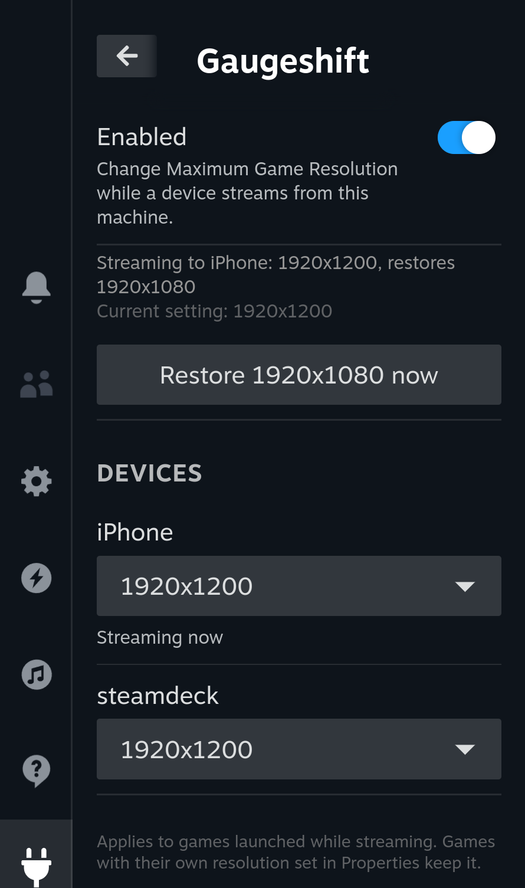

# Gaugeshift


[](https://github.com/murphmar/decky-gaugeshift/actions/workflows/release.yml)

**Per-device game resolution for Remote Play and Steam Link.**

Gaugeshift is a [Decky Loader](https://decky.xyz) plugin for SteamOS machines you stream _from_, such as a Steam Machine or a docked Steam Deck. When a device starts streaming, Gaugeshift sets Steam's **Maximum Game Resolution** for that device. When the stream ends, it puts the setting back.

<p align="center">
  
</p>

## Why

If your machine is connected to a 4K TV, games streamed to a Steam Deck or a phone still render at 4K. The picture is then scaled down to fit the device, which costs performance and can add black bars.

Steam's **Settings → Display → Maximum Game Resolution** fixes this, but it's a single global setting you'd have to change every time you switch between the TV and another device. Steam's menu also only offers resolutions that suit the connected display, so 16:10 sizes like 1280x800 may be missing when it's a 16:9 TV.

Gaugeshift changes the setting automatically for each device, and accepts any resolution.

## Features

- **No setup needed.** A device streaming for the first time gets a resolution matching its own screen: 1280x800 for a Steam Deck, or the size the device reports.
- **Per-device rules.** Set any device to match its screen, a fixed resolution, **Native**, a custom size, or **Don't change**.
- **Restores your setting.** When a stream ends, the previous value comes back, not just "Default". If you change the setting yourself during a stream, Gaugeshift keeps your change.
- **Both kinds of streaming:**
  - **Steam Link** on a phone, tablet or TV.
  - **Remote Play from another Steam device**, such as a Steam Deck choosing **Stream** on a game. Gaugeshift catches these launches before the game starts.
- **Safe across restarts.** If Steam, Decky or the machine restarts mid-stream, the setting is still restored.
- **Clear notifications.** When the setting changes, a notification shows the resolution, for example "Maximum Resolution: 1280x800".

## Install

Gaugeshift isn't in the Decky Plugin Store. Install it from a URL:

1. In Decky's settings (Quick Access Menu → Decky tab → gear icon), turn on **Developer mode**.
2. In the **Developer** section, choose **Install Plugin from URL** and enter:
   ```
   https://github.com/murphmar/decky-gaugeshift/releases/latest/download/gaugeshift.zip
   ```
3. Confirm the install prompt.

## Use

Stream as usual. Each new device gets the **New devices** setting, which is **Match their screen** by default:

- **A Steam Deck** gets 1280x800 from its first stream.
- **Other devices** report their screen size a couple of seconds after connecting, and Gaugeshift uses it from then on. Devices that streamed before Gaugeshift was installed are recognized immediately.

To change a device's resolution, open **Gaugeshift** in the Quick Access Menu and pick a rule from its menu. For example, setting **steamdeck** to `1920x1200` gives a sharper picture at the cost of performance.

To remove a device, choose **Forget this device…** at the bottom of its menu. Devices paired with Steam Link stay in the list until you unpair them in Steam's Remote Play settings.

### Good to know

- **Games read the setting when they launch.** A game that's already running keeps its resolution until you restart it.
- **Per-game settings take priority.** If a game has its own **Game Resolution** in its Properties, Steam uses that instead.
- **Steam Decks are recognized by name.** SteamOS names a Deck `steamdeck`. A Deck with a different name gets its size from its first stream instead.
- **The first launch from a brand-new device may be missed.** A device other than a Steam Deck that launches a game with **Stream** before it has ever streamed may start that one game at the usual resolution. Later launches use its screen size.
- **Remote launches are matched to a device in advance.** Steam only says which device launched a game once its stream connects, which is too late. Gaugeshift applies the rule of the online device that streamed most recently, then corrects it if the stream turns out to be a different device. If no stream follows within a minute, the change is undone.

### Warnings

If something isn't working, the panel shows a warning:

| Warning                                       | What Gaugeshift does                                                                                      |
| --------------------------------------------- | --------------------------------------------------------------------------------------------------------- |
| Can't read Maximum Game Resolution            | Changes nothing, since it couldn't restore the old value afterwards.                                      |
| Couldn't change the resolution                | Leaves the setting as it was.                                                                             |
| Couldn't put the resolution back              | Retries on the next stream or restart. You can also press **Restore**, or set it in Settings → Display.   |
| Launches from other devices can't be detected | Steam Link still works. Games launched from another Steam device may start before the resolution changes. |

These usually mean a Steam update changed something. Please [open an issue](https://github.com/murphmar/decky-gaugeshift/issues/new/choose).

## How it works

Gaugeshift listens to Steam's Remote Play events to see which device is streaming. It reads Steam's streaming log for each device's screen size, and Steam's console log to detect launches from other Steam devices early. It saves the current value before changing the setting.

[ARCHITECTURE.md](ARCHITECTURE.md) describes the code in detail. The Steam functions Gaugeshift relies on aren't officially documented, so a Steam update could break something. If that happens, Gaugeshift shows a warning and leaves the setting alone.

## Safety

Gaugeshift doesn't need root, doesn't use the network and can't run other programs. It only touches one Steam setting, its own settings file, and two of Steam's logs (read-only). An automated check enforces this on every build, and releases can be verified against the source code. See [SECURITY.md](SECURITY.md).

## How this was made

Gaugeshift was built by Mark with an AI coding assistant (Claude, by Anthropic), which wrote most of the code under Mark's direction and review. For that reason it isn't eligible for the Decky Plugin Store, which doesn't accept AI-written code.

To make it trustworthy anyway:

- **About 200 automated tests** run on every change, including randomized stress tests. The tests were also run against deliberately broken versions of the code to confirm they catch real bugs. See [docs/TESTING.md](docs/TESTING.md).
- **Each release is tested on real hardware** against a written checklist, with the results published.
- **Its permissions are limited** and checked automatically. See [Safety](#safety).
- **The code is documented** for review and maintenance. See [ARCHITECTURE.md](ARCHITECTURE.md).

## Support

- **Last tested on:** SteamOS 3.10.0 (Preview), Steam client Beta (November 2026), Decky Loader 3.3.1. See the [test results](docs/TESTING.md#results).
- **Problems:** use the [bug report form](https://github.com/murphmar/decky-gaugeshift/issues/new/choose) and attach the Gaugeshift log.
- **Security issues:** see [SECURITY.md](SECURITY.md#reporting-a-security-problem).

## Development

Requirements: Node.js 22, Python 3.11+ and `zip`. Run `corepack enable` once so `pnpm` matches the version pinned in `package.json` (pnpm 9, which Decky's tooling expects).

```sh
pnpm install
pnpm check            # types, formatting, tests with coverage, build, safety check, audit
pip install pytest pytest-cov ruff
ruff check . && pytest tests/backend --cov=main
./package.sh          # writes out/gaugeshift.zip
```

- `src/engine.ts` makes all the decisions and doesn't touch Steam directly. It's tested in `tests/frontend` against a simulated Steam.
- `src/steam.ts` and `src/host.ts` connect the engine to Steam and the backend.
- `main.py` stores settings and reads Steam's logs. It's tested in `tests/backend`.

Every push and pull request runs all checks. To release, add the version to `CHANGELOG.md`, update `version` in `package.json`, and push a matching tag such as `v0.6.0`.

## License

BSD 3-Clause. See [LICENSE](LICENSE). Based on the [Decky plugin template](https://github.com/SteamDeckHomebrew/decky-plugin-template).

Not affiliated with or endorsed by Valve. Steam, Steam Deck, Steam Link and Remote Play are trademarks of Valve Corporation.
